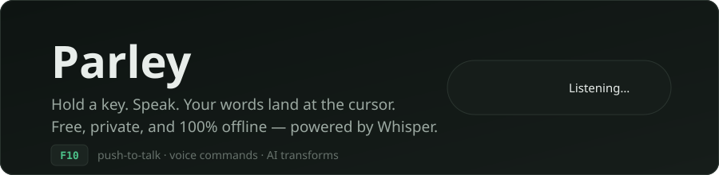
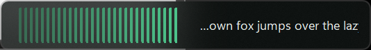
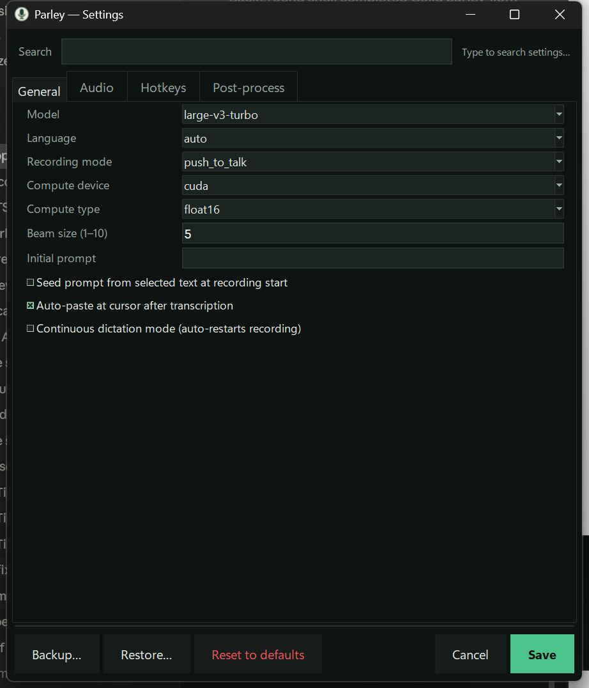
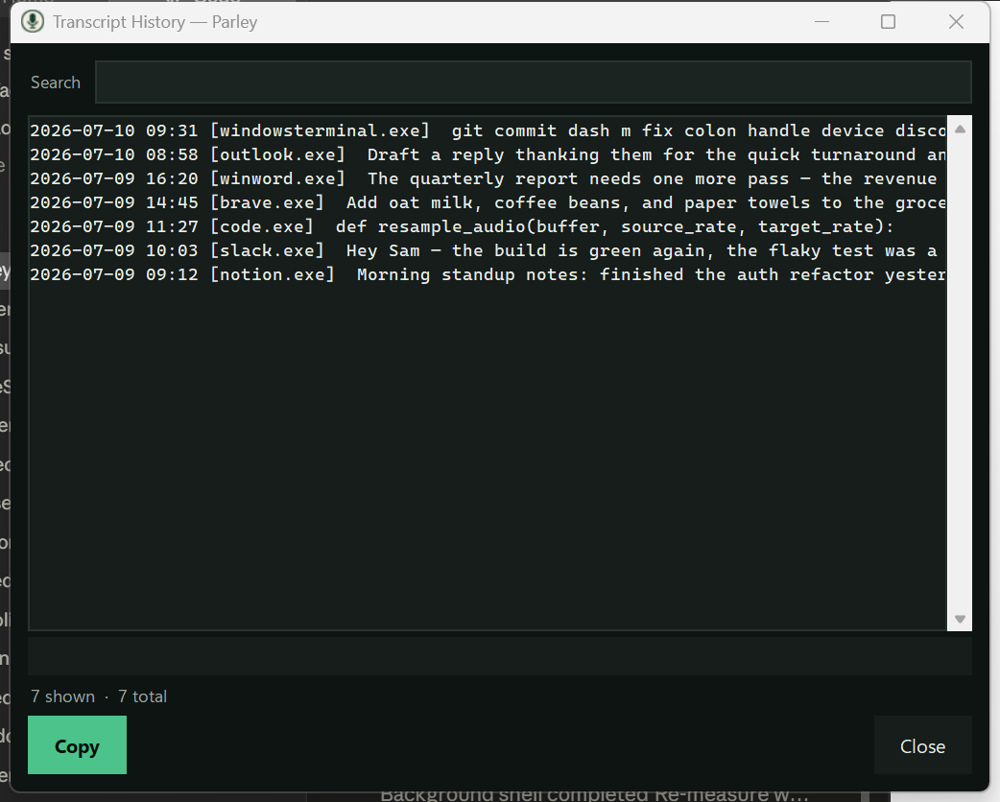
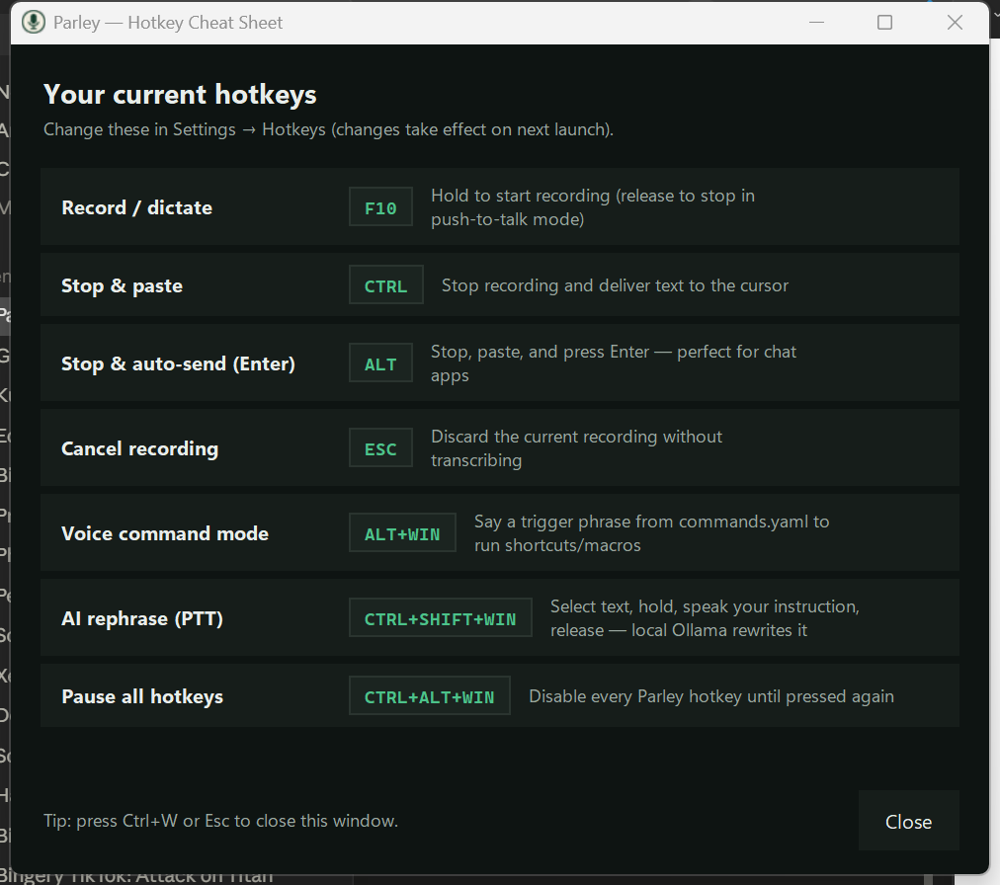
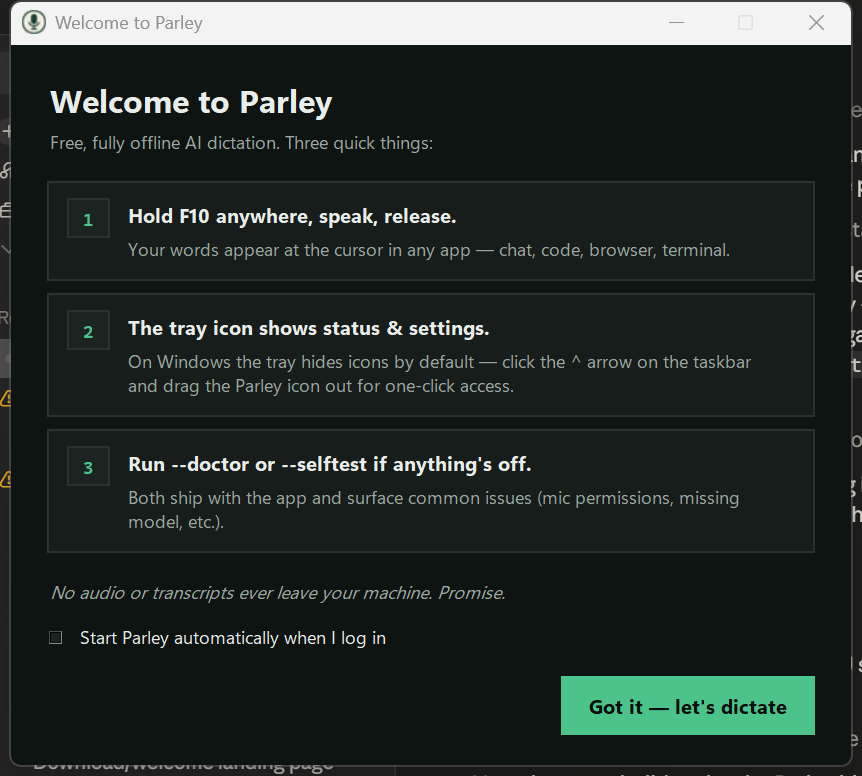

# Parley

**Push-to-talk voice dictation for Windows. Hold a key, speak, and your words land at the cursor — clean, fast, and 100% offline.**

[](https://github.com/Parusann/parley/actions/workflows/test.yml)
[](LICENSE)
[](https://github.com/Parusann/parley)
[](https://github.com/Parusann/parley)



I built Parley because I wanted what the paid dictation apps do — hold a key, talk, get clean text in whatever app has focus — without sending a single sample of my voice to someone else's server. Parley runs OpenAI's Whisper entirely on your machine. No account, no subscription, no telemetry, no network dependency after setup.



## What it does

- **Hold a hotkey, speak, release** — text appears at your cursor in any app. An always-on audio buffer with 0.5 s of pre-roll means your first word is never clipped.
- **GPU-fast** — on AMD GPUs a warm whisper.cpp Vulkan server keeps `large-v3-turbo` resident in VRAM: a dictation round-trips in **~135 ms**. NVIDIA (CUDA) and CPU paths are built in too.
- **Your vocabulary, guaranteed** — deterministic fuzzy correction snaps near-misses back to your own terms ("Amadies" → "Amadeus") with zero hallucination, and hotwords bias Whisper's decoding directly.
- **Optional local LLM cleanup** — an Ollama pass strips filler words without rephrasing you; if Ollama is down you get the raw transcript, never a blocked dictation.
- **Per-app rules** — different formatting and paste behavior for terminals, password fields, and code editors.
- **Voice commands & AI transforms** — "open notepad", "make this concise", rephrase-selection with your own prompt library.
- **A calm glass overlay** — a scrolling waveform pill with live streaming text shows exactly what Parley hears while you talk. Dark/light aware, DPI-crisp, reduced-motion friendly.
- **Diagnostics that don't lie** — `parley --doctor` reports the backend that's *actually* active and whether a GPU is *actually* visible; `parley --selftest` exercises mic → model → transcription → clipboard end to end.

## Quick start

**Option 1 — Standalone app (no Python required)**

Download `parley.exe` from [Releases](https://github.com/Parusann/parley/releases), run it, and hold **F10** to dictate. First launch sets up a private Python runtime and downloads the default Whisper model (~141 MB); after that it's fully offline. Windows SmartScreen will warn once (unsigned) — *More info → Run anyway*.

**Option 2 — pip**

```bash
pip install parley
parley
```

**Option 3 — from source**

```bash
git clone https://github.com/Parusann/parley
cd parley
python -m venv .venv && .venv\Scripts\activate
pip install -e .
parley
```

Then: hold **F10**, say "testing Parley one two three", release. The waveform pill appears while you speak; the text lands where your cursor is.

## GPU acceleration

| GPU | Path | Setup |
|---|---|---|
| AMD (RDNA 2+) | whisper.cpp **Vulkan** server | `parley --setup-vulkan`, then set `whisper.backend: whisper_cpp_server` |
| NVIDIA | faster-whisper **CUDA** | see [docs/gpu-setup.md](docs/gpu-setup.md) |
| None / anything | CPU (faster-whisper int8) | works out of the box |

Every GPU artifact Parley downloads is **pinned to an exact version and SHA-256-verified** before it's trusted — see the provenance notes in [docs/gpu-setup.md](docs/gpu-setup.md). `parley --doctor` will tell you honestly which backend is live.

## The UI

| | |
|---|---|
|  |  |
|  |  |

One identity everywhere: green ink on dark paper (or light — Parley follows your Windows theme, and `PARLEY_THEME=dark|light` overrides it). Per-monitor DPI aware, keyboard navigable, and animations respect your OS reduced-motion setting.

## Configuration

Everything lives in `%APPDATA%\parley\user_settings.yaml` (a settings window is in the tray menu). The essentials:

```yaml
whisper:
  model: base              # tiny/base/small/medium/large-v3/large-v3-turbo
  backend: faster_whisper  # or whisper_cpp_server (GPU on AMD), whisper_cpp
  hotwords: [Parley, CTranslate2]   # your names & jargon — also feeds vocab correction

hotkey:
  recording_hotkey: f10    # push-to-talk key

post_process:
  ollama:
    enabled: false         # optional local LLM cleanup
```

## CLI reference

| Command | What it does |
|---|---|
| `parley` | run the app (tray + hotkeys) |
| `parley --doctor` | full health check: audio, model, GPU, hotkeys, config |
| `parley --selftest` | automated mic → model → transcribe → clipboard test |
| `parley --setup-vulkan` | install the verified AMD GPU runtime |
| `parley --settings` / `--history` | settings editor / transcript history windows |
| `parley --add-word NAME` | add a word to your dictionary |
| `parley --import-vocab <folder>` | mine hotwords from a codebase |
| `parley --serve` | local OpenAI-compatible transcription API |
| `parley --bundle-logs` | redacted diagnostic zip for bug reports |

## Privacy

Your voice never leaves your machine. No audio, transcripts, or usage data is uploaded anywhere, ever. The only network traffic is the one-time model/runtime download you explicitly trigger (hash-verified), and an *opt-in* daily GitHub release check. The optional Ollama pass talks to `localhost`.

## How it works

```
hold hotkey ──> always-on recorder (0.5s pre-roll) ──> TEN-VAD gate
      ──> Whisper backend (Vulkan server / faster-whisper / whisper.cpp)
      ──> vocab correction ──> per-app formatting ──> optional Ollama polish
      ──> paste at cursor (or clipboard / capture window)
```

A persistent tray app owns global hotkeys and the overlay; transcription backends are hot-swappable behind one interface; if the GPU server dies mid-session it's restarted once and your utterance retried, and if it can't start at all Parley falls back to CPU rather than refusing to launch.

## Documentation

- [FAQ](docs/faq.md) · [Troubleshooting](docs/troubleshooting.md) · [GPU setup](docs/gpu-setup.md) · [Voice commands](docs/voice-commands.md) · [Streaming mode](docs/streaming.md)
- [Architecture index](docs/project-index.md) · [Platform abstraction](docs/platform-abstraction.md)
- Performance: `python tools/benchmark_latency.py` measures warm dictation latency against any backend.

## Contributing

Issues and PRs welcome — see [CONTRIBUTING.md](CONTRIBUTING.md). The full test suite (`pytest tests/ -q`) must stay green; UI changes must add zero per-dictation latency.

## Credits & license

MIT — see [LICENSE](LICENSE). Parley builds on the excellent work of [drajb/whisper-local](https://github.com/drajb/whisper-local) and its parent [PinW/whisper-key-local](https://github.com/PinW/whisper-key-local), and stands on [OpenAI Whisper](https://github.com/openai/whisper), [whisper.cpp](https://github.com/ggml-org/whisper.cpp), [faster-whisper](https://github.com/SYSTRAN/faster-whisper), [CTranslate2](https://github.com/OpenNMT/CTranslate2), [TEN VAD](https://github.com/TEN-framework/ten-vad), and more — the full list is in [AUTHORS.md](AUTHORS.md).
